# 🛡️ Cahier d'Exercices : Apprendre Angular

Bienvenue dans ton nouveau terrain d'entraînement ! Cette fois, plus de terminal noir : ton aventure se déroule **dans le navigateur**.

Ces exercices suivent les notions de base de la documentation officielle ([angular.dev/overview](https://angular.dev/overview) et [angular.dev/essentials](https://angular.dev/essentials)) :

| Module | Notion | Doc officielle |
|---|---|---|
| 0 | Mise en place du projet | [CLI](https://angular.dev/tools/cli) |
| 1 | Composants | [Components](https://angular.dev/essentials/components) |
| 2 | Signals (réactivité) | [Signals](https://angular.dev/essentials/signals) |
| 3 | Templates dynamiques | [Templates](https://angular.dev/essentials/templates), [Control flow](https://angular.dev/guide/templates/control-flow) |
| 4 | Communication entre composants | [Inputs](https://angular.dev/guide/components/inputs), [Outputs](https://angular.dev/guide/components/outputs) |
| 5 | Formulaires avec signals | [Signal Forms](https://angular.dev/essentials/signal-forms) |
| 6 | Services et injection de dépendances | [Dependency injection](https://angular.dev/essentials/dependency-injection) |
| 7 | Routage | [Routing](https://angular.dev/guide/routing) |
| 8 | Projet final : Le Marché de l'Aventurier | Tout ! |

**Règle du jeu :** pour chaque exercice, obtiens dans ton navigateur le **Résultat attendu**. Les captures sont prises sur le corrigé : le contenu doit correspondre, le style visuel est libre.

> 💡 Ne copie pas les indices les yeux fermés : essaie d'abord seul, puis ouvre la doc officielle. C'est elle ton grimoire.

---

## Module 0 : Mise en place du campement

### Comment est organisé ce dossier ?

```text
Angular/
├── base-project/              <- TON projet : les squelettes à compléter (// TODO)
│   ├── SUJET.md               <- ce cahier
│   └── captures/              <- les résultats attendus
└── solutions/                 <- les corrigés (à n'ouvrir qu'après avoir essayé !)
```

Dans `base-project/src/app/`, chaque exercice a son dossier (`module-3/ex-3-4-inventaire/`, etc.). L'application affiche un **menu à gauche** : clique sur un exercice pour voir ton travail. L'URL correspond au numéro de l'exercice (`/ex-3-4`).

### Exercice 0.1 : Installer la forge

Prérequis : **Node.js** (version LTS) installé. Vérifie dans un terminal :

```bash
node --version
```

Installe ensuite l'outil en ligne de commande d'Angular :

```bash
npm install -g @angular/cli
```

Installe les dépendances du projet de départ (une seule fois) :

```bash
cd Angular/base-project
npm install
```

Lance le serveur de développement :

```bash
ng serve
```

Ouvre `http://localhost:4200` dans ton navigateur. Laisse `ng serve` tourner : à chaque sauvegarde, la page se met à jour toute seule.

**Résultat attendu :** le menu des exercices s'affiche, la page de l'exercice 1.1 est vide.

*Pour comparer avec le corrigé : même chose dans `Angular/solutions`, avec `ng serve --port 4201` pour pouvoir lancer les deux en même temps.*

### Exercice 0.2 : Explorer la carte

Ouvre le dossier `base-project/src` et trouve le rôle de chaque fichier. Complète ce tableau dans un fichier `notes.md` :

| Fichier | À quoi sert-il ? |
|---|---|
| `src/main.ts` | ? |
| `src/app/app.ts` | ? |
| `src/app/app.html` | ? |
| `src/app/app.css` | ? |
| `src/app/app.config.ts` | ? |
| `src/app/app.routes.ts` | ? |

> 💡 Indice : `main.ts` démarre l'application avec `bootstrapApplication(App, appConfig)`. Remonte le fil à partir de là.

*Bonus : crée un projet vierge dans un autre dossier avec `ng new mon-projet` et compare sa structure avec celle de `base-project`.*

---

## Module 1 : Les Composants

Un composant = une **classe TypeScript** + un décorateur `@Component` + un **template HTML** + un **sélecteur CSS** (+ des styles optionnels).

### Exercice 1.1 : L'écran-titre

Fichier : `module-1/ex-1-1-ecran-titre/ecran-titre.ts`. Complète le template inline (`template:`) pour afficher l'écran-titre du jeu.

**Résultat attendu :**

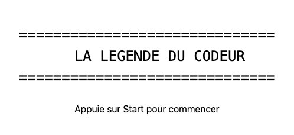

*Bonus : dans `styles:`, centre le texte et mets le titre en grand.*

### Exercice 1.2 : La fiche du héros

Dossier : `module-1/ex-1-2-fiche-heros/`. Ce composant a été créé avec la CLI :

```bash
ng generate component fiche-heros
```

1. Observe les trois fichiers : `.ts` (la classe), `.html` (le template), `.css` (les styles). Repère dans le `.ts` comment ils sont reliés (`templateUrl`, `styleUrl`).
2. Dans `fiche-heros.html`, affiche les informations d'un héros (en dur pour l'instant).
3. *Bonus :* dans `fiche-heros.css`, encadre la fiche.

**Résultat attendu :**

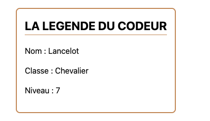

*Pour t'entraîner : génère toi-même un composant `brouillon` (`ng generate component brouillon`) dans `src/app/`, observe les fichiers créés, puis supprime-le.*

### Exercice 1.3 : La taverne (composition)

Dossier : `module-1/ex-1-3-taverne/`. Complète les composants `Tavernier` et `Client`, puis fais en sorte que `Taverne` **contienne** un `Tavernier` et **trois** `Client`.

Ici, tout est en **template inline** (`template:`) et **styles inline** (`styles:`), sans fichier `.html` ni `.css`.

**Résultat attendu :**

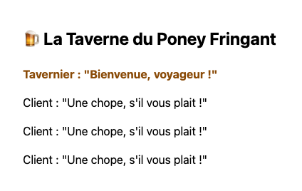

> 💡 Les trois étapes pour utiliser un composant : `import { Client } from './client';` puis `imports: [Client]` dans le décorateur, puis `<app-client />` dans le template.

*Question : les styles écrits dans `Tavernier` s'appliquent-ils aussi aux `<p>` de `Client` ? Teste et explique pourquoi.*

---

## Module 2 : La réactivité avec les Signals

Un signal est une boîte qui contient une valeur. On la **lit** en l'appelant comme une fonction (`pv()`), on la **modifie** avec `set()` ou `update()`. Un `computed()` est un signal en lecture seule, recalculé automatiquement.

### Exercice 2.1 : Le sac de potions

Complète le composant `SacPotions` avec un signal `potions` initialisé à `3`.

* `[Boire]` retire 1 potion.
* `[Acheter]` ajoute 1 potion.
* `[Vider le sac]` remet le compteur à 0.

**Résultat attendu (après 2 clics sur Acheter) :**


> 💡 `potions = signal(3);` puis `this.potions.update(n => n + 1);` et `this.potions.set(0);`. Dans le template : `{{ potions() }}` et `(click)="acheter()"`.

### Exercice 2.2 : La barre de vie

Complète le composant `BarreDeVie` avec deux signals : `pv` (80) et `pvMax` (100). Ajoute deux signaux **calculés** :

* `pourcentage` : `pv / pvMax * 100`, arrondi.
* `etat` : `"En pleine forme"` si > 70 %, `"Blessé"` si > 30 %, sinon `"Au bord du gouffre"`.

Ajoute les boutons `[Recevoir un coup (-15)]` et `[Se soigner (+10)]`. Les PV ne doivent jamais passer sous 0 ni au-dessus de `pvMax`.

**Résultat attendu :**

*Etat initial :*

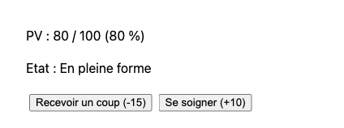

*Après 2 coups :*

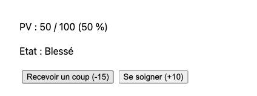

> 💡 `pourcentage = computed(() => Math.round(this.pv() / this.pvMax() * 100));` et `Math.max(0, ...)` / `Math.min(...)` pour borner.

*Question : tu n'as jamais appelé `pourcentage.set(...)`. Pourquoi l'affichage se met-il quand même à jour ?*

### Exercice 2.3 : Le changement de nom

Complète le composant `NomDuHeros` avec un signal `nom` (`"Morgan"`) et un `computed` `nomEnMajuscules`. Ajoute un bouton `[Renommer]` qui change le nom en `"Jaime"`.

**Résultat attendu :**

*Avant le clic :*

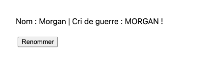

*Après le clic sur Renommer :*


---

## Module 3 : Les Templates dynamiques

### Exercice 3.1 : La boutique du forgeron (property binding)

Complète le composant `Forge` avec :

* un signal `or` (pièces du joueur) initialisé à `40`,
* une constante `PRIX_EPEE = 50`.

Le bouton `[Acheter l'épée]` doit être **désactivé** (`[disabled]`) tant que le joueur n'a pas assez d'or. Ajoute un bouton `[Miner (+5 or)]`. Quand l'épée est achetée, retire le prix de la bourse.

Ajoute aussi une classe CSS `pauvre` (texte rouge) sur l'affichage de l'or quand `or < PRIX_EPEE`, avec `[class.pauvre]="..."`.

**Résultat attendu :**

*Au départ (or en rouge, bouton Acheter grisé) :*


*Après 2 clics sur Miner :*

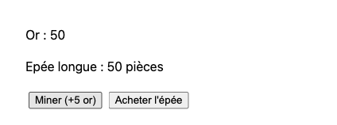

### Exercice 3.2 : Le parchemin magique (event binding et `$event`)

Complète le composant `Parchemin` avec un champ texte. À chaque frappe, le texte saisi s'affiche en dessous, ainsi que son nombre de caractères.

**Résultat attendu :**

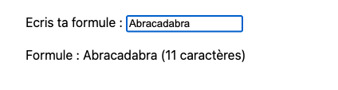

> 💡 `(input)="ecrire($event)"` et dans la classe : `ecrire(event: Event) { const champ = event.target as HTMLInputElement; ... }`

### Exercice 3.3 : Le videur de la taverne (`@if` / `@else`)

Complète le composant `Videur` avec un signal `niveau` (initialisé à `4`) et deux boutons `[Niveau +1]` / `[Niveau -1]`.

* Si le niveau est ≥ 10 : `"Entre donc, grand guerrier !"`
* Sinon : `"Désolé gamin, il faut être au moins niveau 10."`

**Résultat attendu :**

*Niveau 4 :*

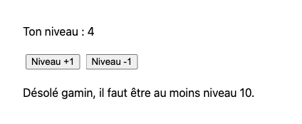

*Niveau 10 :*


### Exercice 3.4 : L'inventaire (`@for`, `track`, `@empty`)

Complète le composant `Inventaire` avec un signal contenant un tableau d'objets :

```ts
interface Objet {
  id: number;
  nom: string;
  poids: number;
}
```

Initialise-le avec 3 objets (Epée 3 kg, Bouclier 5 kg, Potion 0.5 kg).

1. Affiche la liste avec `@for` (n'oublie pas `track objet.id`) et le numéro de chaque ligne avec `$index`.
2. Chaque ligne a un bouton `[Jeter]` qui retire l'objet du tableau.
3. Affiche le **poids total** grâce à un `computed`.
4. Quand l'inventaire est vide, affiche `"Ton sac est vide."` grâce à `@empty`.

**Résultat attendu :**

*Au départ :*

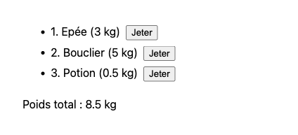

*Après avoir tout jeté :*


> 💡 Ne modifie jamais le tableau directement (`push`, `splice`) : crée un **nouveau** tableau. `this.objets.update(liste => liste.filter(o => o.id !== id));`

### Exercice 3.5 : Le choix de classe (`@switch`)

Complète le composant `ChoixClasse` avec trois boutons `[Guerrier]`, `[Mage]`, `[Voleur]` qui mettent à jour un signal `classe`. Affiche une description différente avec `@switch` / `@case` / `@default`.

**Résultat attendu :**

*Aucune classe choisie :*

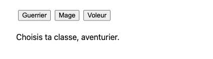

*Après un clic sur Mage :*

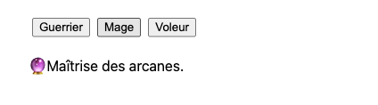

---

## Module 4 : Communication entre composants

* Parent → enfant : `input()` dans l'enfant, `[propriete]="valeur"` dans le parent.
* Enfant → parent : `output()` dans l'enfant, `(evenement)="methode($event)"` dans le parent.
* Dans les deux sens : `model()` dans l'enfant, `[(propriete)]="monSignal"` dans le parent.

### Exercice 4.1 : Le bestiaire (`input()`)

Complète le composant `CarteMonstre` qui reçoit trois inputs :

* `nom` : **obligatoire** (`input.required<string>()`),
* `pv` : obligatoire,
* `rang` : optionnel, valeur par défaut `"Commun"`.

Dans le composant parent `Bestiaire`, affiche trois cartes avec des valeurs différentes.

**Résultat attendu :**


*Question : que se passe-t-il à la compilation si tu oublies de passer `[nom]` à une carte ?*

### Exercice 4.2 : Le combat (`output()`)

Dans `module-4/ex-4-2-combat/`, recopie ta `CarteMonstre` de l'exercice 4.1 et ajoute-lui un bouton `[Attaquer]`. Au clic, la carte **émet** un événement `attaque` contenant le nom du monstre (`output<string>()`).

Le parent `Combat` écoute cet événement et affiche un journal de combat (liste des dernières attaques).

**Résultat attendu (après avoir attaqué Gobelin puis Dragon, bonus inclus) :**


*Bonus : le parent stocke les PV de chaque monstre dans un signal et retire 10 PV au monstre attaqué. La carte ne doit **jamais** modifier ses PV elle-même : c'est le parent qui possède la donnée.*

### Exercice 4.3 : Le sélecteur de quantité (`model()`)

Complète le composant réutilisable `SelecteurQuantite` avec un `model(1)` nommé `quantite` et deux boutons `[-]` / `[+]` (minimum 1, maximum 10).

Dans le parent `Comptoir`, utilise-le avec `[(quantite)]="nbPotions"` (où `nbPotions` est un signal du parent) et affiche le prix total (15 pièces la potion) via un `computed`.

**Résultat attendu :**

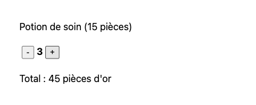

*Question : quelle est la différence entre ce que tu as fait ici et un couple `input()` + `output()` ?*

---

## Module 5 : Les formulaires avec signals

On décrit les données dans un **signal modèle**, on crée le formulaire avec `form()`, puis on relie chaque champ HTML avec la directive `[formField]`. Tout vient de `@angular/forms/signals`.

### Exercice 5.1 : L'inscription à la guilde

Complète le composant `InscriptionGuilde` avec ce modèle :

```ts
interface Recrue {
  pseudo: string;
  email: string;
  niveau: number;
  classe: string;
}
```

Règles de validation :

* `pseudo` : obligatoire, 3 caractères minimum.
* `email` : obligatoire, format email valide.
* `niveau` : minimum 1, maximum 99.
* `classe` : obligatoire (liste déroulante : Guerrier, Mage, Voleur).

Affiche les messages d'erreur sous chaque champ **seulement** quand le champ a été touché (`touched()`) et qu'il est invalide. Le bouton `[Rejoindre la guilde]` est désactivé tant que le formulaire est invalide. À la soumission, affiche un message de bienvenue.

**Résultat attendu :**

*Champs touchés et invalides :*

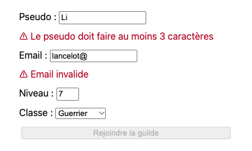

*Formulaire corrigé et soumis :*

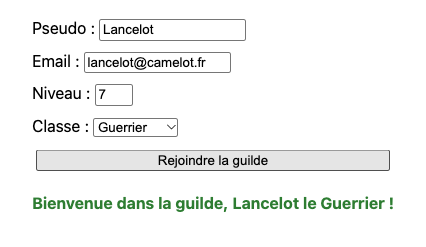

> 💡 Squelette :
> ```ts
> import { email, form, FormField, max, min, minLength, required } from '@angular/forms/signals';
>
> recrue = signal<Recrue>({ pseudo: '', email: '', niveau: 1, classe: '' });
>
> formulaire = form(this.recrue, (chemin) => {
>   required(chemin.pseudo, { message: 'Le pseudo est obligatoire' });
>   // TODO : les autres règles
> });
> ```
> Dans le template : `<input [formField]="formulaire.pseudo" />`, et pour lire l'état : `formulaire.pseudo().errors()`, `formulaire().valid()`.
> N'oublie pas `imports: [FormField]` dans le décorateur et `event.preventDefault()` dans ta méthode de soumission.

*Question : ouvre la console et affiche `this.recrue()` à chaque frappe. Où sont stockées les valeurs saisies ?*

---

## Module 6 : Services et injection de dépendances

Un **service** est une classe qui contient de la logique ou des données **partagées** entre plusieurs composants. On le récupère dans un composant avec `inject()`.

> ⚠️ Depuis Angular v22, la doc utilise le décorateur `@Service()`. Si ton projet est plus ancien, utilise `@Injectable({ providedIn: 'root' })` : le principe est le même.

### Exercice 6.1 : Le calculateur du marchand

Le service `Marchand` (fichier `marchand.ts`, créé avec `ng generate service marchand`) expose une méthode `prixTotal(prixUnitaire: number, quantite: number): number` qui applique une **remise de 10 %** à partir de 5 objets achetés.

Utilise-le dans le composant `Facture` via `inject(Marchand)`.

**Résultat attendu :**

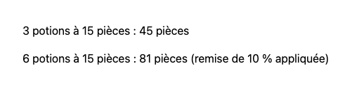

### Exercice 6.2 : Le coffre partagé

Complète le service `Coffre` qui contient un signal `or` (100 pièces) et deux méthodes : `deposer(montant)` et `retirer(montant)` (refuse si pas assez d'or).

Complète **deux composants indépendants** qui injectent le même service :

* `Banquier` : affiche l'or et propose `[Déposer 10]`.
* `Aventurier` : affiche l'or et propose `[Dépenser 25]`.

Le composant `SalleDuCoffre` les affiche déjà côte à côte.

**Résultat attendu (après 1 clic sur Dépenser 25) :**


*Question : les deux composants affichent toujours la même valeur. Pourquoi ? Que se passerait-il si chaque composant créait son propre `new Coffre()` ?*

> 💡 Dans le service, expose le signal en lecture seule pour que personne ne le modifie sans passer par tes méthodes : `private readonly _or = signal(100);` puis `readonly or = this._or.asReadonly();`

---

## Module 7 : Le routage

Le routeur affiche un composant différent selon l'URL. Trois pièces : les **routes** (`Routes`), la **sortie** (`<router-outlet />`) et les **liens** (`routerLink`).

> 🗺️ Le menu de gauche utilise déjà le routeur (va lire `app.routes.ts` et `app.html`). Pour ne pas le casser, chaque exercice de ce module est une **mini-application montée sous son URL** : l'exercice 7.1 vit sous `/ex-7-1/...`, ses routes sont des **routes enfants** définies dans son propre fichier `*.routes.ts`. Conséquence : dans tes `routerLink`, utilise des chemins **relatifs** (`routerLink="taverne"`, sans `/` au début).

### Exercice 7.1 : La carte du royaume

Dossier : `module-7/ex-7-1-carte-royaume/`. Complète le texte des quatre pages : `Accueil`, `Taverne`, `Boutique` et `PageIntrouvable`.

1. Dans `carte-royaume.routes.ts`, définis les routes :
   * `''` → `Accueil` (titre d'onglet : `"Accueil"`)
   * `'taverne'` → `Taverne`
   * `'boutique'` → `Boutique`
   * `'auberge'` → **redirige** vers `taverne`
   * `'**'` → `PageIntrouvable`
2. Observe dans `app.config.ts` comment le routeur est activé (`provideRouter(routes)`) et dans `app.routes.ts` comment `CARTE_ROYAUME_ROUTES` est branché (`children`).
3. Dans `carte-royaume.ts`, ajoute la barre de navigation avec `routerLink` (le `<router-outlet />` est déjà là). Importe `RouterLink` dans le composant.
4. Mets en gras le lien de la page active avec `routerLinkActive="actif"`. Pour le lien Accueil (`routerLink="."`), ajoute `[routerLinkActiveOptions]="{ exact: true }"` : sinon, il resterait actif sur toutes les pages. Pourquoi ?

**Résultat attendu :**

*URL `/ex-7-1` :*

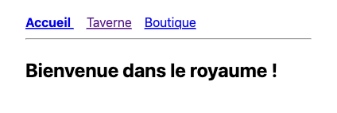

*Après un clic sur Taverne (`/ex-7-1/taverne`, ou `/ex-7-1/auberge` qui redirige) :*

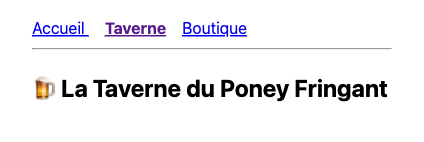

*URL inconnue `/ex-7-1/dragon` :*


*Question : en naviguant, la page se recharge-t-elle entièrement ? Regarde l'onglet Réseau des outils de développement.*

### Exercice 7.2 : La fiche de monstre (paramètres de route)

Dossier : `module-7/ex-7-2-bestiaire/`. Complète la méthode `trouver(id: number)` du service `BestiaireService` (la liste des monstres est fournie).

1. Dans `bestiaire.routes.ts`, `''` redirige vers `'bestiaire'`, qui affiche `ListeMonstres`, et `'bestiaire/:id'` affiche `DetailMonstre`.
2. Page `ListeMonstres` : affiche chaque monstre avec un lien vers sa fiche (`[routerLink]="[monstre.id]"`).
3. Page `DetailMonstre` : lit l'`id` dans l'URL et affiche la fiche complète.
4. Ajoute sur la fiche un bouton `[Retour au bestiaire]` qui navigue **par le code** avec `Router.navigate`.
5. Si l'id n'existe pas, affiche `"Monstre inconnu."`.

**Résultat attendu :**

*URL `/ex-7-2/bestiaire` :*

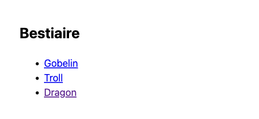

*URL `/ex-7-2/bestiaire/3` :*


*URL `/ex-7-2/bestiaire/42` :*

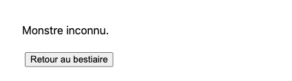

> 💡 `withComponentInputBinding()` est déjà activé dans `app.config.ts` (`provideRouter(routes, withComponentInputBinding())`). Le paramètre `:id` arrive donc directement dans un input du composant : `id = input.required<string>();`. Attention, c'est une `string` : convertis-la avec `Number(...)`.
> Pour le retour en relatif : `this.router.navigate(['..'], { relativeTo: inject(ActivatedRoute) })` (récupère `ActivatedRoute` avec `inject()` dans un champ de la classe).
> Autre méthode pour lire l'id (à tester ensuite) : `inject(ActivatedRoute)` et `params.subscribe(...)`.

---

## Module 8 : Projet final : Le Marché de l'Aventurier

Combine toutes les notions dans une mini-application. Dossier : `module-8/projet-final/`, URL : `/ex-8`. Les fichiers sont créés et le catalogue d'objets est fourni ; à toi de tout câbler.

### Cahier des charges

**Routes :**

| URL | Page |
|---|---|
| `/ex-8` | Accueil : création du héros (formulaire) |
| `/ex-8/marche` | Liste des objets à vendre |
| `/ex-8/marche/:id` | Détail d'un objet + achat avec quantité |
| `/ex-8/sac` | Inventaire du héros |
| `/ex-8/**` | Page 404 |

**Services :**

* `HerosService` : nom, classe, or (signal, 200 pièces au départ), méthodes `depenser()` et `gagner()`.
* `CatalogueService` : liste des objets en vente (`id`, `nom`, `prix`, `poids`, `categorie`).
* `SacService` : objets achetés (signal), `acheter()`, `vendre()` (rend 50 % du prix au héros), poids total (`computed`). Un service peut injecter un autre service : `inject(HerosService)`.

**Fonctionnalités :**

1. **Création du héros** (Module 5) : pseudo obligatoire (3 caractères min.), classe obligatoire. Tant que le héros n'est pas créé, le marché affiche `"Crée d'abord ton héros !"` (`@if`).
2. **En-tête permanent** (Modules 1, 6, 7) : nom du héros, or restant, nombre d'objets dans le sac, liens de navigation.
3. **Marché** (Modules 3, 4) : un composant `CarteObjet` réutilisable (`input()` pour l'objet, `output()` pour le clic sur `[Voir]`). Filtre par catégorie (Armes / Armures / Potions) avec un `computed`.
4. **Détail et achat** (Modules 4, 7) : réutilise ton `SelecteurQuantite` de l'exercice 4.3 (`model()`), en l'important depuis `../../module-4/ex-4-3-comptoir/selecteur-quantite`. Le bouton `[Acheter]` est désactivé si l'or est insuffisant ou si le poids total dépasse **30 kg**.
5. **Sac** (Module 3) : liste avec `@for` / `@empty`, bouton `[Vendre]` sur chaque objet, poids et valeur totale.

**Résultat attendu (parcours complet) :**

*Marché avant la création du héros :*

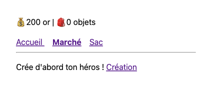

*Héros créé :*

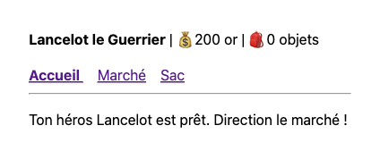

*Marché :*

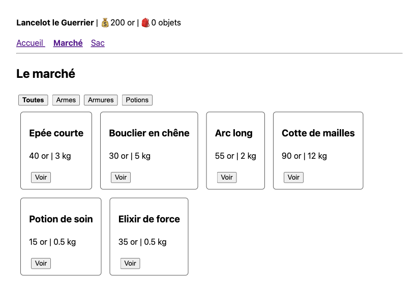

*Détail `/ex-8/marche/2` après l'achat de 2 boucliers :*

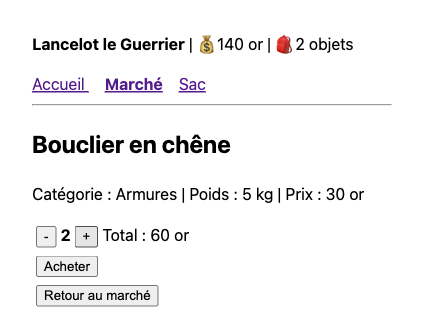

*Sac :*

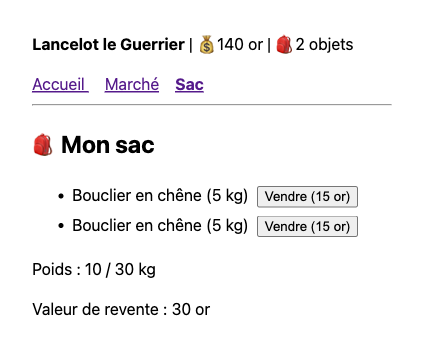

### Bonus

* Sauvegarde le héros et le sac dans le `localStorage` pour les retrouver après un rechargement (cherche `effect()` dans la doc des signals).
* Ajoute un objet légendaire visible uniquement à partir de 1000 pièces d'or.
* Ouvre les [Angular DevTools](https://angular.dev/tools/devtools) dans ton navigateur et observe l'arbre de tes composants.

---

🏆 **Félicitations, aventurier !** Tu maîtrises les bases d'Angular. Pour aller plus loin : le [tutoriel interactif officiel](https://angular.dev/tutorials/learn-angular) et le guide [Next Steps](https://angular.dev/essentials/next-steps).
