# 🗿 Cahier d'Exercices : Apprendre Angular (édition Brainrot)

Bienvenue dans l'Ohio, chef. Ici, pas de terminal noir : tout se passe **dans le navigateur**, avec Tralalero Tralala, Tung Tung Tung Sahur, Bombardiro Crocodilo et toute la team.

Ces exercices suivent les notions de base de la documentation officielle ([angular.dev/overview](https://angular.dev/overview) et [angular.dev/essentials](https://angular.dev/essentials)) :

| Module | Notion | Doc officielle |
|---|---|---|
| 0 | Mise en place du projet | [CLI](https://angular.dev/tools/cli) |
| 1 | Composants | [Components](https://angular.dev/essentials/components) |
| 2 | Signals (réactivité) | [Signals](https://angular.dev/essentials/signals) |
| 3 | Templates dynamiques | [Templates](https://angular.dev/essentials/templates), [Control flow](https://angular.dev/guide/templates/control-flow) |
| 4 | Communication entre composants | [Inputs](https://angular.dev/guide/components/inputs), [Outputs](https://angular.dev/guide/components/outputs) |
| 5 | Formulaires avec signals | [Signal Forms](https://angular.dev/essentials/signal-forms) |
| 6 | Services et injection de dépendances | [Dependency injection](https://angular.dev/essentials/dependency-injection) |
| 7 | Routage | [Routing](https://angular.dev/guide/routing) |
| 8 | Projet final : Le Brainrot Shop | Tout ! |

**Règle du jeu :** pour chaque exercice, obtiens dans ton navigateur le **Résultat attendu**. Les captures sont prises sur le corrigé : le contenu doit correspondre, le style visuel est libre.

> 💡 Ne copie pas les indices sans réfléchir : essaie d'abord seul, puis ouvre la doc officielle. Copier sans comprendre, c'est -1000 d'aura.

---

## Module 0 : Spawn dans l'Ohio

### Comment est organisé ce dossier ?

```text
Angular/projet-1-brainrot/
├── base-project/              <- TON projet : les squelettes à compléter (// TODO)
│   ├── SUJET.md               <- ce cahier
│   └── captures/              <- les résultats attendus
└── solutions/                 <- les corrigés (à n'ouvrir qu'après avoir essayé !)
```

Dans `base-project/src/app/`, chaque exercice a son dossier (`module-3/ex-3-4-playlist/`, etc.). L'application affiche un **menu à gauche** : clique sur un exercice pour voir ton travail. L'URL correspond au numéro de l'exercice (`/ex-3-4`).

### Exercice 0.1 : Installer le setup

Prérequis : **Node.js** (version LTS) installé. Vérifie dans un terminal :

```bash
node --version
```

Installe ensuite l'outil en ligne de commande d'Angular :

```bash
npm install -g @angular/cli
```

Installe les dépendances du projet de départ (une seule fois) :

```bash
cd Angular/projet-1-brainrot/base-project
npm install
```

Lance le serveur de développement :

```bash
ng serve
```

Ouvre `http://localhost:4200` dans ton navigateur. Laisse `ng serve` tourner : à chaque sauvegarde, la page se met à jour toute seule.

**Résultat attendu :** le menu des exercices s'affiche, la page de l'exercice 1.1 est vide.

*Pour comparer avec le corrigé : même chose dans `Angular/projet-1-brainrot/solutions`, avec `ng serve --port 4201` pour pouvoir lancer les deux en même temps.*

### Exercice 0.2 : Explorer la map

Ouvre le dossier `base-project/src` et trouve le rôle de chaque fichier. Complète ce tableau dans un fichier `notes.md` :

| Fichier | À quoi sert-il ? |
|---|---|
| `src/main.ts` | ? |
| `src/app/app.ts` | ? |
| `src/app/app.html` | ? |
| `src/app/app.css` | ? |
| `src/app/app.config.ts` | ? |
| `src/app/app.routes.ts` | ? |

> 💡 Indice : `main.ts` démarre l'application avec `bootstrapApplication(App, appConfig)`. Remonte le fil à partir de là.

*Bonus : crée un projet vierge dans un autre dossier avec `ng new mon-projet` et compare sa structure avec celle de `base-project`.*

---

## Module 1 : Les Composants

Un composant = une **classe TypeScript** + un décorateur `@Component` + un **template HTML** + un **sélecteur CSS** (+ des styles optionnels).

### Exercice 1.1 : L'écran-titre

Fichier : `module-1/ex-1-1-ecran-titre/ecran-titre.ts`. Complète le template inline (`template:`) pour afficher l'écran-titre du jeu.

**Résultat attendu :**


*Bonus : dans `styles:`, centre le texte et mets le titre en grand.*

### Exercice 1.2 : La fiche brainrot

Dossier : `module-1/ex-1-2-fiche-brainrot/`. Ce composant a été créé avec la CLI :

```bash
ng generate component fiche-brainrot
```

1. Observe les trois fichiers : `.ts` (la classe), `.html` (le template), `.css` (les styles). Repère dans le `.ts` comment ils sont reliés (`templateUrl`, `styleUrl`).
2. Dans `fiche-brainrot.html`, affiche la fiche de Tralalero Tralala (en dur pour l'instant).
3. *Bonus :* dans `fiche-brainrot.css`, encadre la fiche.

**Résultat attendu :**

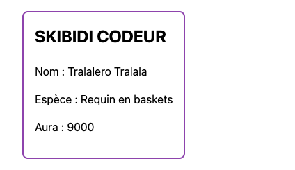

*Pour t'entraîner : génère toi-même un composant `brouillon` (`ng generate component brouillon`) dans `src/app/`, observe les fichiers créés, puis supprime-le.*

### Exercice 1.3 : Le Café de l'Ohio (composition)

Dossier : `module-1/ex-1-3-cafe-ohio/`. Complète les composants `Barista` (Ballerina Cappuccina) et `Client` (Tung Tung Tung Sahur), puis fais en sorte que `CafeOhio` **contienne** une `Barista` et **trois** `Client`.

Ici, tout est en **template inline** (`template:`) et **styles inline** (`styles:`), sans fichier `.html` ni `.css`.

**Résultat attendu :**

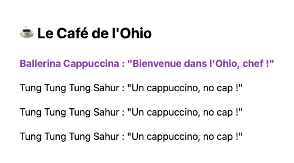

> 💡 Les trois étapes pour utiliser un composant : `import { Client } from './client';` puis `imports: [Client]` dans le décorateur, puis `<app-client />` dans le template.

*Question : les styles écrits dans `Barista` s'appliquent-ils aussi aux `<p>` de `Client` ? Teste et explique pourquoi.*

---

## Module 2 : La réactivité avec les Signals

Un signal est une boîte qui contient une valeur. On la **lit** en l'appelant comme une fonction (`aura()`), on la **modifie** avec `set()` ou `update()`. Un `computed()` est un signal en lecture seule, recalculé automatiquement.

### Exercice 2.1 : La réserve de bananes

Complète le composant `ReserveBananes` avec un signal `bananes` initialisé à `3` (la réserve de Chimpanzini Bananini).

* `[Manger]` retire 1 banane.
* `[Acheter]` ajoute 1 banane.
* `[Tout donner]` remet le compteur à 0.

**Résultat attendu (après 2 clics sur Acheter) :**

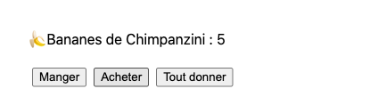

> 💡 `bananes = signal(3);` puis `this.bananes.update(n => n + 1);` et `this.bananes.set(0);`. Dans le template : `{{ bananes() }}` et `(click)="acheter()"`.

### Exercice 2.2 : La jauge d'aura

Complète le composant `JaugeAura` avec deux signals : `aura` (80) et `auraMax` (100). Ajoute deux signaux **calculés** :

* `pourcentage` : `aura / auraMax * 100`, arrondi.
* `etat` : `"Sigma absolu 🗿"` si > 70 %, `"Ça passe"` si > 30 %, sinon `"Totalement cooked 💀"`.

Ajoute les boutons `[Faire un truc cringe (-15)]` et `[Mewing (+10)]`. L'aura ne doit jamais passer sous 0 ni au-dessus de `auraMax`.

**Résultat attendu :**

*Etat initial :*

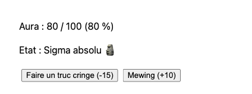

*Après 2 trucs cringe :*

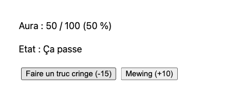

> 💡 `pourcentage = computed(() => Math.round(this.aura() / this.auraMax() * 100));` et `Math.max(0, ...)` / `Math.min(...)` pour borner.

*Question : tu n'as jamais appelé `pourcentage.set(...)`. Pourquoi l'affichage se met-il quand même à jour ?*

### Exercice 2.3 : Le changement de nom

Complète le composant `NomDuBrainrot` avec un signal `nom` (`"Tralalero Tralala"`) et un `computed` `cri` (le nom en majuscules). Ajoute un bouton `[Renommer]` qui change le nom en `"Bombardiro Crocodilo"`.

**Résultat attendu :**

*Avant le clic :*

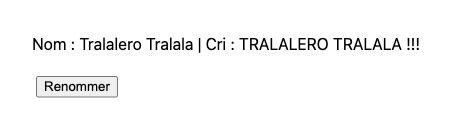

*Après le clic sur Renommer :*

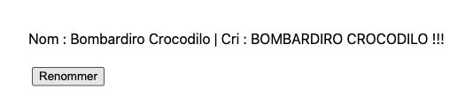

---

## Module 3 : Les Templates dynamiques

### Exercice 3.1 : La boutique de skins (property binding)

Complète le composant `BoutiqueSkins` avec :

* un signal `credits` initialisé à `40`,
* une constante `PRIX_SKIN = 50`.

Le bouton `[Acheter le skin]` doit être **désactivé** (`[disabled]`) tant que tu n'as pas assez de crédits. Ajoute un bouton `[Scroller (+5 crédits)]`. Quand le skin est acheté, retire le prix des crédits.

Ajoute aussi une classe CSS `fauche` (texte rouge) sur l'affichage des crédits quand `credits < PRIX_SKIN`, avec `[class.fauche]="..."`.

**Résultat attendu :**

*Au départ (crédits en rouge, bouton Acheter grisé) :*

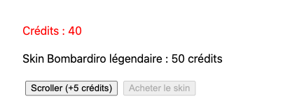

*Après 2 clics sur Scroller :*


### Exercice 3.2 : La caption (event binding et `$event`)

Complète le composant `Caption` avec un champ texte. À chaque frappe, le texte saisi s'affiche en dessous, ainsi que son nombre de caractères.

**Résultat attendu :**


> 💡 `(input)="ecrire($event)"` et dans la classe : `ecrire(event: Event) { const champ = event.target as HTMLInputElement; ... }`

### Exercice 3.3 : Le videur du club des sigmas (`@if` / `@else`)

Complète le composant `Videur` avec un signal `aura` (initialisé à `4`) et deux boutons `[Aura +1]` / `[Aura -1]`.

* Si l'aura est ≥ 10 : `"Bienvenue au club des sigmas 🗿"`
* Sinon : `"Désolé chef, il faut au moins 10 d'aura. Reviens plus tard."`

**Résultat attendu :**

*Aura 4 :*

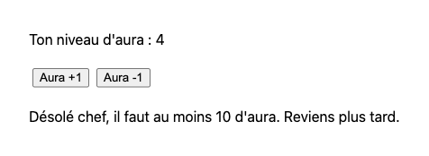

*Aura 10 :*

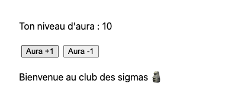

### Exercice 3.4 : La playlist (`@for`, `track`, `@empty`)

Complète le composant `Playlist` avec un signal contenant un tableau de sons :

```ts
interface Son {
  id: number;
  titre: string;
  duree: number;
}
```

Initialise-le avec 3 sons (Tralalero Tralala 45 s, Tung Tung Tung Sahur 30 s, Brr Brr Patapim 20 s).

1. Affiche la liste avec `@for` (n'oublie pas `track son.id`) et le numéro de chaque ligne avec `$index`.
2. Chaque ligne a un bouton `[Supprimer]` qui retire le son du tableau.
3. Affiche la **durée totale** grâce à un `computed`.
4. Quand la playlist est vide, affiche `"Ta playlist est vide."` grâce à `@empty`.

**Résultat attendu :**

*Au départ :*

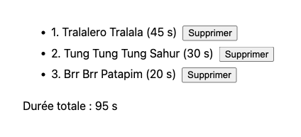

*Après avoir tout supprimé :*

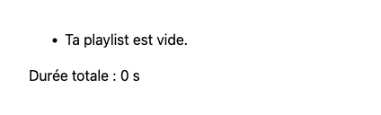

> 💡 Ne modifie jamais le tableau directement (`push`, `splice`) : crée un **nouveau** tableau. `this.sons.update(liste => liste.filter(s => s.id !== id));`

### Exercice 3.5 : Le choix de team (`@switch`)

Complète le composant `ChoixTeam` avec trois boutons `[Tralalero]`, `[Bombardiro]`, `[Tung Tung]` qui mettent à jour un signal `team`. Affiche une description différente avec `@switch` / `@case` / `@default`.

**Résultat attendu :**

*Aucune team choisie :*


*Après un clic sur Bombardiro :*

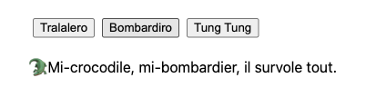

---

## Module 4 : Communication entre composants

* Parent → enfant : `input()` dans l'enfant, `[propriete]="valeur"` dans le parent.
* Enfant → parent : `output()` dans l'enfant, `(evenement)="methode($event)"` dans le parent.
* Dans les deux sens : `model()` dans l'enfant, `[(propriete)]="monSignal"` dans le parent.

### Exercice 4.1 : La collection (`input()`)

Complète le composant `CarteBrainrot` qui reçoit trois inputs :

* `nom` : **obligatoire** (`input.required<string>()`),
* `aura` : obligatoire,
* `rarete` : optionnel, valeur par défaut `"Commun"`.

Dans le composant parent `Collection`, affiche trois cartes : Brr Brr Patapim (30, Commun), Chimpanzini Bananini (120, Epique), Bombardiro Crocodilo (500, Légendaire).

**Résultat attendu :**

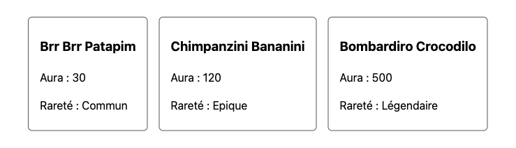

*Question : que se passe-t-il à la compilation si tu oublies de passer `[nom]` à une carte ?*

### Exercice 4.2 : La battle (`output()`)

Dans `module-4/ex-4-2-battle/`, recopie ta `CarteBrainrot` de l'exercice 4.1 et ajoute-lui un bouton `[Clasher]`. Au clic, la carte **émet** un événement `clash` contenant le nom du brainrot (`output<string>()`).

Le parent `Battle` écoute cet événement et affiche l'historique de la battle.

**Résultat attendu (après avoir clashé Brr Brr Patapim puis Bombardiro Crocodilo, bonus inclus) :**

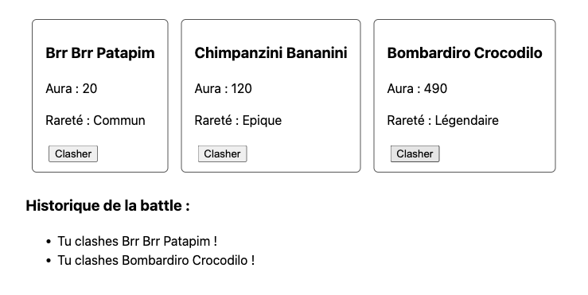

*Bonus : le parent stocke l'aura de chaque brainrot dans un signal et retire 10 d'aura au brainrot clashé. La carte ne doit **jamais** modifier son aura elle-même : c'est le parent qui possède la donnée.*

### Exercice 4.3 : La commande (`model()`)

Complète le composant réutilisable `SelecteurQuantite` avec un `model(1)` nommé `quantite` et deux boutons `[-]` / `[+]` (minimum 1, maximum 10).

Dans le parent `Commande`, utilise-le avec `[(quantite)]="nbCafes"` (où `nbCafes` est un signal du parent) et affiche le prix total (15 crédits le Cappuccino Assassino) via un `computed`.

**Résultat attendu :**

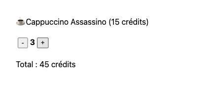

*Question : quelle est la différence entre ce que tu as fait ici et un couple `input()` + `output()` ?*

---

## Module 5 : Les formulaires avec signals

On décrit les données dans un **signal modèle**, on crée le formulaire avec `form()`, puis on relie chaque champ HTML avec la directive `[formField]`. Tout vient de `@angular/forms/signals`.

### Exercice 5.1 : L'inscription à la squad

Complète le composant `InscriptionSquad` avec ce modèle :

```ts
interface Membre {
  pseudo: string;
  email: string;
  niveau: number;
  team: string;
}
```

Règles de validation :

* `pseudo` : obligatoire, 3 caractères minimum.
* `email` : obligatoire, format email valide.
* `niveau` : minimum 1, maximum 99.
* `team` : obligatoire (liste déroulante : Tralalero, Bombardiro, Tung Tung).

Affiche les messages d'erreur sous chaque champ **seulement** quand le champ a été touché (`touched()`) et qu'il est invalide. Le bouton `[Rejoindre la squad]` est désactivé tant que le formulaire est invalide. À la soumission, affiche un message de bienvenue.

**Résultat attendu :**

*Champs touchés et invalides :*

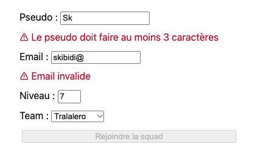

*Formulaire corrigé et soumis :*

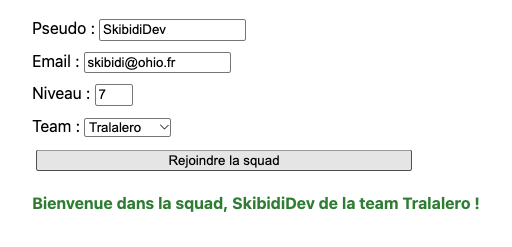

> 💡 Squelette :
> ```ts
> import { email, form, FormField, max, min, minLength, required } from '@angular/forms/signals';
>
> membre = signal<Membre>({ pseudo: '', email: '', niveau: 1, team: '' });
>
> formulaire = form(this.membre, (chemin) => {
>   required(chemin.pseudo, { message: 'Le pseudo est obligatoire' });
>   // TODO : les autres règles
> });
> ```
> Dans le template : `<input [formField]="formulaire.pseudo" />`, et pour lire l'état : `formulaire.pseudo().errors()`, `formulaire().valid()`.
> N'oublie pas `imports: [FormField]` dans le décorateur et `event.preventDefault()` dans ta méthode de soumission.

*Question : ouvre la console et affiche `this.membre()` à chaque frappe. Où sont stockées les valeurs saisies ?*

---

## Module 6 : Services et injection de dépendances

Un **service** est une classe qui contient de la logique ou des données **partagées** entre plusieurs composants. On le récupère dans un composant avec `inject()`.

> ⚠️ Depuis Angular v22, la doc utilise le décorateur `@Service()`. Si ton projet est plus ancien, utilise `@Injectable({ providedIn: 'root' })` : le principe est le même.

### Exercice 6.1 : Le ticket de caisse

Le service `Caisse` (fichier `caisse.ts`, créé avec `ng generate service caisse`) expose une méthode `prixTotal(prixUnitaire: number, quantite: number): number` qui applique une **remise de 10 %** à partir de 5 articles achetés.

Utilise-le dans le composant `Ticket` via `inject(Caisse)`.

**Résultat attendu :**

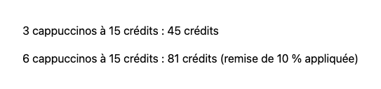

### Exercice 6.2 : La cagnotte du live

Complète le service `Cagnotte` qui contient un signal `credits` (100) et deux méthodes : `deposer(montant)` et `retirer(montant)` (refuse si la cagnotte ne suffit pas).

Complète **deux composants indépendants** qui injectent le même service :

* `Streamer` : affiche la cagnotte et propose `[Recevoir un don (+10)]`.
* `Pote` : affiche la cagnotte et propose `[Prélever la taxe (-25)]`.

Le composant `Live` les affiche déjà côte à côte.

**Résultat attendu (après 1 clic sur Prélever la taxe) :**

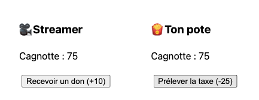

*Question : les deux composants affichent toujours la même valeur. Pourquoi ? Que se passerait-il si chaque composant créait sa propre `new Cagnotte()` ?*

> 💡 Dans le service, expose le signal en lecture seule pour que personne ne le modifie sans passer par tes méthodes : `private readonly _credits = signal(100);` puis `readonly credits = this._credits.asReadonly();`

---

## Module 7 : Le routage

Le routeur affiche un composant différent selon l'URL. Trois pièces : les **routes** (`Routes`), la **sortie** (`<router-outlet />`) et les **liens** (`routerLink`).

> 🗺️ Le menu de gauche utilise déjà le routeur (va lire `app.routes.ts` et `app.html`). Pour ne pas le casser, chaque exercice de ce module est une **mini-application montée sous son URL** : l'exercice 7.1 vit sous `/ex-7-1/...`, ses routes sont des **routes enfants** définies dans son propre fichier `*.routes.ts`. Conséquence : dans tes `routerLink`, utilise des chemins **relatifs** (`routerLink="cafe"`, sans `/` au début).

### Exercice 7.1 : La carte de l'Ohio

Dossier : `module-7/ex-7-1-carte-ohio/`. Complète le texte des quatre pages : `Accueil`, `Cafe`, `Boutique` et `PageIntrouvable`.

1. Dans `carte-ohio.routes.ts`, définis les routes :
   * `''` → `Accueil` (titre d'onglet : `"Accueil"`)
   * `'cafe'` → `Cafe`
   * `'boutique'` → `Boutique`
   * `'coffee-shop'` → **redirige** vers `cafe`
   * `'**'` → `PageIntrouvable`
2. Observe dans `app.config.ts` comment le routeur est activé (`provideRouter(routes)`) et dans `app.routes.ts` comment `CARTE_OHIO_ROUTES` est branché (`children`).
3. Dans `carte-ohio.ts`, ajoute la barre de navigation avec `routerLink` (le `<router-outlet />` est déjà là). Importe `RouterLink` dans le composant.
4. Mets en gras le lien de la page active avec `routerLinkActive="actif"`. Pour le lien Accueil (`routerLink="."`), ajoute `[routerLinkActiveOptions]="{ exact: true }"` : sinon, il resterait actif sur toutes les pages. Pourquoi ?

**Résultat attendu :**

*URL `/ex-7-1` :*

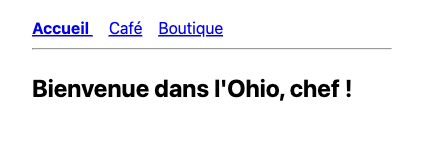

*Après un clic sur Café (`/ex-7-1/cafe`, ou `/ex-7-1/coffee-shop` qui redirige) :*


*URL inconnue `/ex-7-1/skibidi` :*

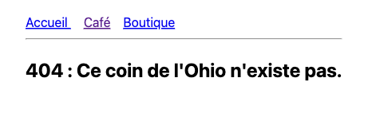

*Question : en naviguant, la page se recharge-t-elle entièrement ? Regarde l'onglet Réseau des outils de développement.*

### Exercice 7.2 : Le Brainrotdex (paramètres de route)

Dossier : `module-7/ex-7-2-brainrotdex/`. Complète la méthode `trouver(id: number)` du service `BrainrotdexService` (la liste des brainrots est fournie).

1. Dans `brainrotdex.routes.ts`, `''` redirige vers `'brainrotdex'`, qui affiche `ListeBrainrots`, et `'brainrotdex/:id'` affiche `DetailBrainrot`.
2. Page `ListeBrainrots` : affiche chaque brainrot avec un lien vers sa fiche (`[routerLink]="[brainrot.id]"`).
3. Page `DetailBrainrot` : lit l'`id` dans l'URL et affiche la fiche complète.
4. Ajoute sur la fiche un bouton `[Retour au Brainrotdex]` qui navigue **par le code** avec `Router.navigate`.
5. Si l'id n'existe pas, affiche `"Brainrot inconnu."`.

**Résultat attendu :**

*URL `/ex-7-2/brainrotdex` :*


*URL `/ex-7-2/brainrotdex/3` :*

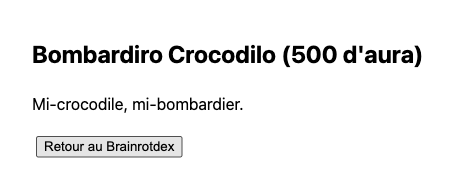

*URL `/ex-7-2/brainrotdex/42` :*

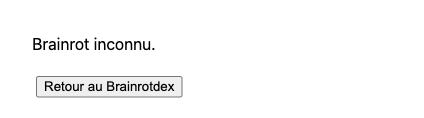

> 💡 `withComponentInputBinding()` est déjà activé dans `app.config.ts` (`provideRouter(routes, withComponentInputBinding())`). Le paramètre `:id` arrive donc directement dans un input du composant : `id = input.required<string>();`. Attention, c'est une `string` : convertis-la avec `Number(...)`.
> Pour le retour en relatif : `this.router.navigate(['..'], { relativeTo: inject(ActivatedRoute) })` (récupère `ActivatedRoute` avec `inject()` dans un champ de la classe).
> Autre méthode pour lire l'id (à tester ensuite) : `inject(ActivatedRoute)` et `params.subscribe(...)`.

---

## Module 8 : Projet final : Le Brainrot Shop

Combine toutes les notions dans une mini-application. Dossier : `module-8/projet-final/`, URL : `/ex-8`. Les fichiers sont créés et le catalogue d'objets est fourni ; à toi de tout câbler.

### Cahier des charges

**Routes :**

| URL | Page |
|---|---|
| `/ex-8` | Création du profil (formulaire) |
| `/ex-8/shop` | Liste des objets à vendre |
| `/ex-8/shop/:id` | Détail d'un objet + achat avec quantité |
| `/ex-8/inventaire` | Inventaire du joueur |
| `/ex-8/**` | Page 404 |

**Services :**

* `ProfilService` : pseudo, team, crédits (signal, 200 au départ), méthodes `depenser()` et `gagner()`.
* `CatalogueService` : liste des objets en vente (`id`, `nom`, `prix`, `taille` en Go, `categorie`).
* `InventaireService` : objets achetés (signal), `acheter()`, `vendre()` (rend 50 % du prix au joueur), stockage total (`computed`). Un service peut injecter un autre service : `inject(ProfilService)`.

**Fonctionnalités :**

1. **Création du profil** (Module 5) : pseudo obligatoire (3 caractères min.), team obligatoire. Tant que le profil n'est pas créé, le shop affiche `"Crée d'abord ton profil !"` (`@if`).
2. **En-tête permanent** (Modules 1, 6, 7) : pseudo et team, crédits restants, nombre d'objets dans l'inventaire, liens de navigation.
3. **Shop** (Modules 3, 4) : un composant `CarteObjet` réutilisable (`input()` pour l'objet, `output()` pour le clic sur `[Voir]`). Filtre par catégorie (Skins / Emotes / Boosts) avec un `computed`.
4. **Détail et achat** (Modules 4, 7) : réutilise ton `SelecteurQuantite` de l'exercice 4.3 (`model()`), en l'important depuis `../../module-4/ex-4-3-commande/selecteur-quantite`. Le bouton `[Acheter]` est désactivé si les crédits sont insuffisants ou si le stockage total dépasse **30 Go**.
5. **Inventaire** (Module 3) : liste avec `@for` / `@empty`, bouton `[Vendre]` sur chaque objet, stockage et valeur totale.

**Résultat attendu (parcours complet) :**

*Shop avant la création du profil :*

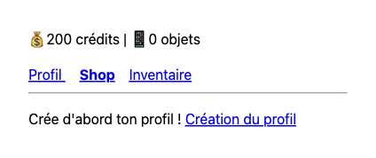

*Profil créé :*

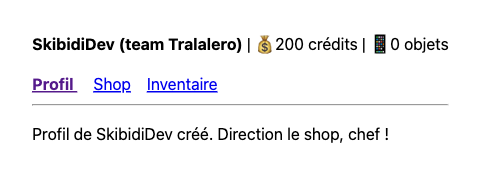

*Shop :*

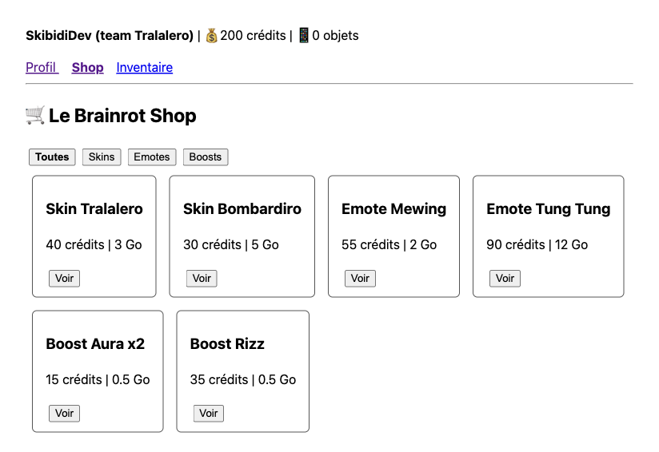

*Détail `/ex-8/shop/2` après l'achat de 2 skins Bombardiro :*

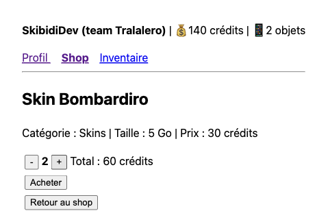

*Inventaire :*

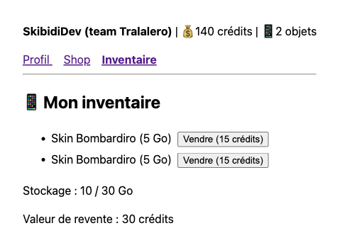

### Bonus

* Sauvegarde le profil et l'inventaire dans le `localStorage` pour les retrouver après un rechargement (cherche `effect()` dans la doc des signals).
* Ajoute un objet légendaire visible uniquement à partir de 1000 crédits.
* Ouvre les [Angular DevTools](https://angular.dev/tools/devtools) dans ton navigateur et observe l'arbre de tes composants.

---

🏆 **GG, chef !** Tu maîtrises les bases d'Angular, aura +∞. Pour aller plus loin : le [tutoriel interactif officiel](https://angular.dev/tutorials/learn-angular) et le guide [Next Steps](https://angular.dev/essentials/next-steps).
