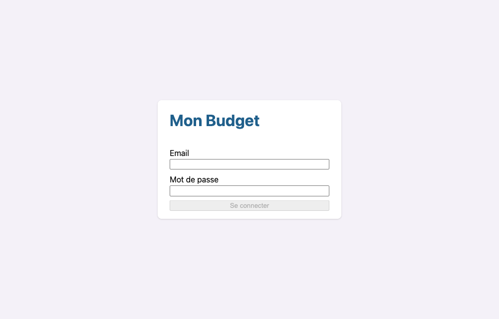
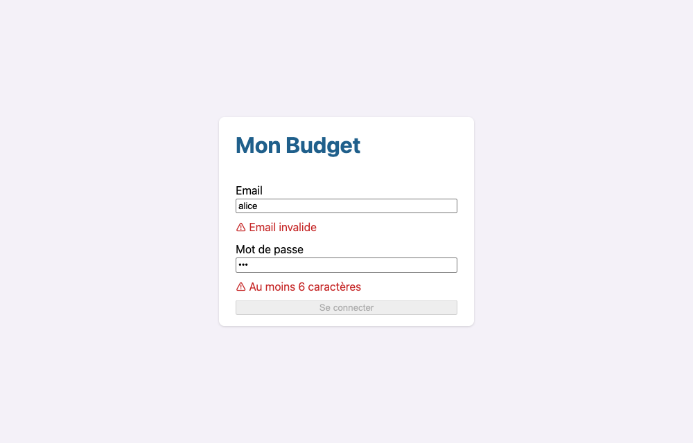
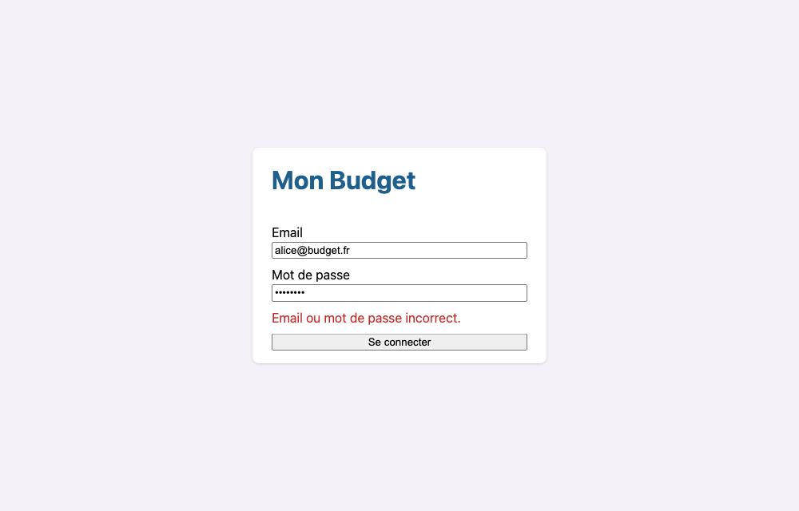
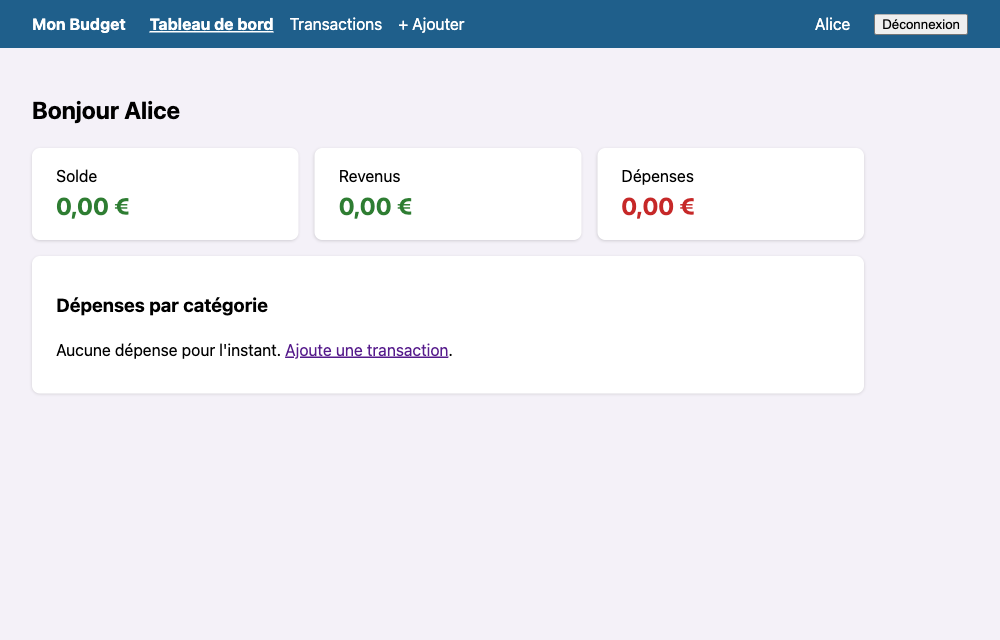
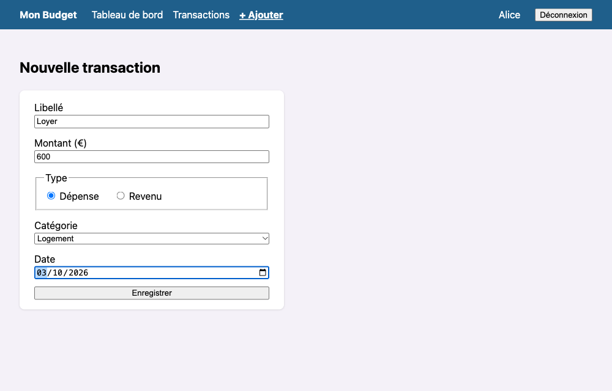
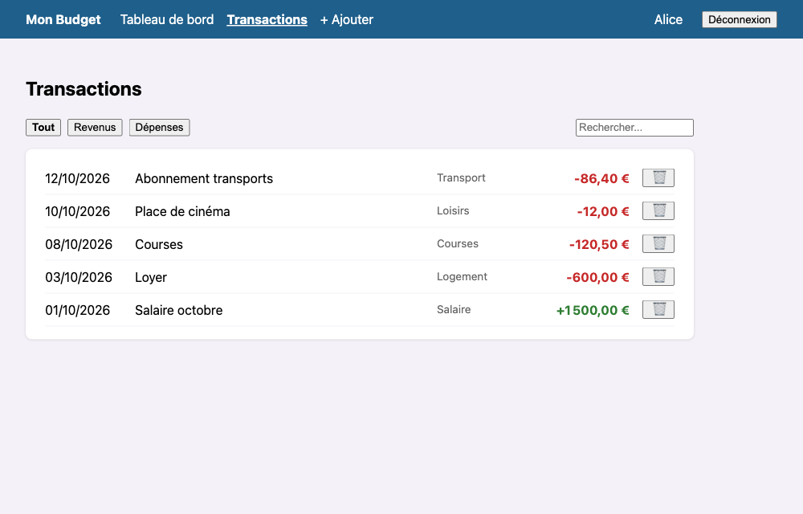
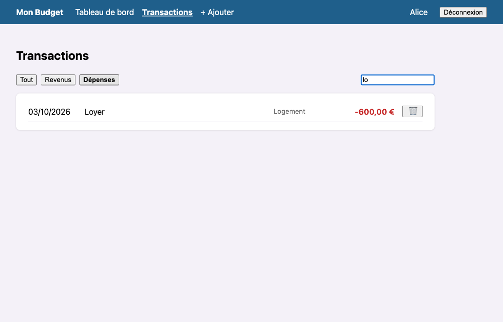
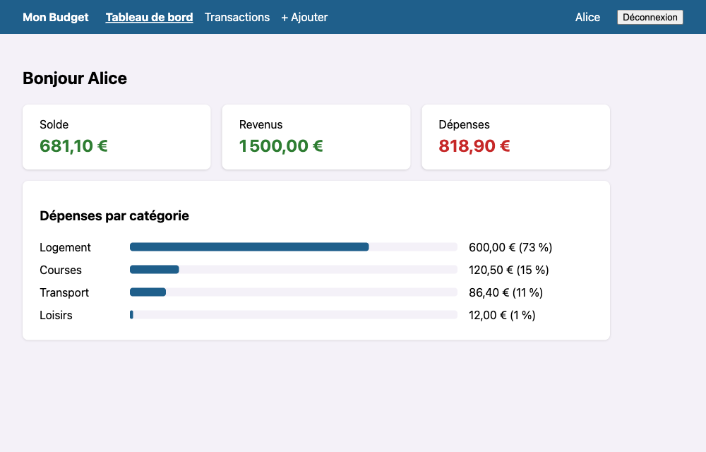
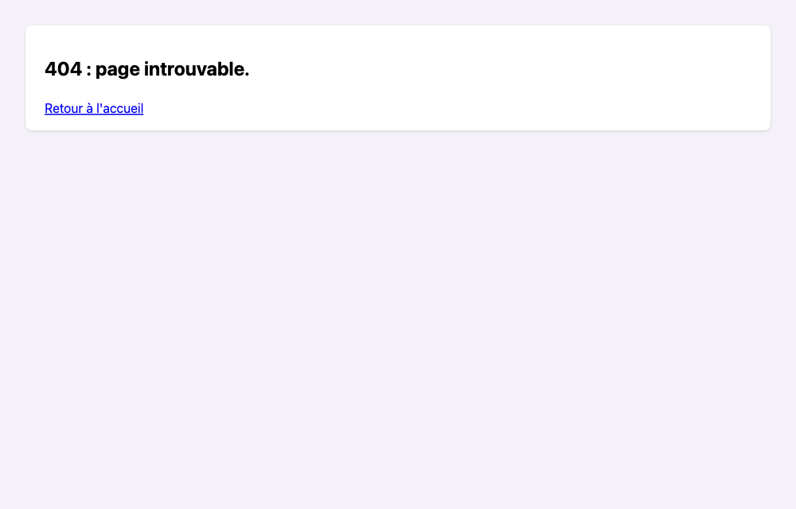

# Projet 2 : Mon Budget

Tu as fini le premier cahier. Cette fois, **pas d'exercices guidés ni de squelettes** : tu reçois un cahier des charges, à toi de concevoir et de coder l'application. C'est ce qui ressemble le plus à un vrai projet.

**Objectif :** une application de gestion de budget personnel, avec connexion, pages protégées, saisie de transactions et tableau de bord.

> ⚠️ **Login pour de faux.** Les comptes sont écrits en dur dans le code (`core/comptes-demo.ts`). C'est acceptable pour apprendre, **jamais** dans une vraie application : un vrai login vérifie le mot de passe sur un serveur, car tout ce qui est dans le front peut être lu par n'importe qui.

---

## 1. Démarrer

```text
Angular/projet-2-budget/
├── base-project/     <- TON projet (presque vide)
│   ├── SUJET.md      <- ce cahier des charges
│   └── captures/     <- les maquettes
└── solutions/        <- une solution possible (à n'ouvrir qu'à la fin !)
```

```bash
cd Angular/projet-2-budget/base-project
npm install
ng serve
```

### Ce qui est fourni

| Fichier | Contenu |
|---|---|
| `models/transaction.ts` | Types `Transaction`, `TypeTransaction`, `Categorie` et la liste `CATEGORIES` |
| `models/utilisateur.ts` | Type `Utilisateur` |
| `core/comptes-demo.ts` | Les deux comptes de test |
| `core/stockage.ts` | Service de lecture / écriture JSON dans `localStorage` |
| `core/date.ts` | `dateDuJour()` : la date locale au format `"2026-10-16"` |
| `app.config.ts` | Routeur (avec `withComponentInputBinding()`) et formats français pour les pipes |
| `styles.css` | Styles globaux : classes `.carte`, `.erreur`, `.revenu`, `.depense` |

Tout le reste (composants, services, guards, routes) est à créer. Utilise la CLI : `ng generate component ...`, `ng generate service ...`, `ng generate guard ...`.

---

## 2. Fonctionnalités attendues

Chaque fonctionnalité est décrite par une **user story** et des **critères d'acceptation**. Une fonctionnalité est terminée quand tous ses critères sont vérifiés.

### F1. Connexion

> En tant qu'utilisateur, je veux me connecter avec mon email et mon mot de passe pour accéder à mon budget.

* [ ] Un formulaire avec email et mot de passe.
* [ ] Email obligatoire et au bon format ; mot de passe obligatoire, 6 caractères minimum. Les erreurs s'affichent sous le champ concerné, une fois qu'il a été touché.
* [ ] Le bouton de connexion est désactivé tant que le formulaire est invalide.
* [ ] Identifiants inconnus : message `Email ou mot de passe incorrect.`
* [ ] Identifiants corrects : redirection vers le tableau de bord.
* [ ] La session survit à un rechargement de la page. Le mot de passe n'est **jamais** stocké.

### F2. Déconnexion et pages protégées

> En tant qu'utilisateur, je veux que mes pages ne soient accessibles qu'une fois connecté.

* [ ] Toutes les pages, sauf la connexion et la page 404, exigent d'être connecté. Sinon : redirection vers la connexion.
* [ ] Un utilisateur déjà connecté qui ouvre la page de connexion est redirigé vers le tableau de bord.
* [ ] Un en-tête commun à toutes les pages connectées : nom de l'application, navigation, pseudo de l'utilisateur, bouton de déconnexion.
* [ ] La déconnexion efface la session et ramène à la page de connexion.

### F3. Ajouter une transaction

> En tant qu'utilisateur, je veux enregistrer mes revenus et mes dépenses.

* [ ] Champs : libellé, montant, type (revenu ou dépense), catégorie, date (aujourd'hui par défaut).
* [ ] Libellé, catégorie et date obligatoires ; montant strictement positif.
* [ ] Après l'enregistrement, redirection vers la liste des transactions.

### F4. Lister et supprimer les transactions

> En tant qu'utilisateur, je veux voir mes transactions et pouvoir en supprimer.

* [ ] Une ligne par transaction : date (`jj/mm/aaaa`), libellé, catégorie, montant signé au format monétaire (`-600,00 €`, `+1 500,00 €`), en rouge ou en vert.
* [ ] Triées de la plus récente à la plus ancienne.
* [ ] Filtres : tout / revenus / dépenses, et recherche sur le libellé.
* [ ] Un bouton de suppression par ligne.
* [ ] Liste vide : un message avec un lien vers l'ajout.

### F5. Tableau de bord

> En tant qu'utilisateur, je veux voir où en est mon budget en un coup d'œil.

* [ ] Un message d'accueil avec le pseudo.
* [ ] Le solde (vert si positif, rouge si négatif), le total des revenus, le total des dépenses.
* [ ] Un avertissement quand le solde est négatif.
* [ ] La répartition des dépenses par catégorie : montant, pourcentage et barre proportionnelle, de la plus grosse à la plus petite.

### F6. Données par utilisateur

> En tant qu'utilisateur, je veux retrouver mes transactions, et seulement les miennes.

* [ ] Les transactions sont sauvegardées et retrouvées après un rechargement.
* [ ] Chaque compte a ses propres transactions : `bob@budget.fr` ne voit pas celles de `alice@budget.fr`.
* [ ] Changer de compte affiche immédiatement les bonnes données, sans recharger la page.

### F7. Page introuvable

* [ ] Une URL inconnue affiche une page 404 avec un lien de retour.

---

## 3. Contraintes techniques

Ton code doit utiliser :

* des **signals** pour l'état (`signal`, `computed`), pas de variables « nues » ;
* les **formulaires avec signals** (`@angular/forms/signals`) ;
* au moins **deux services** injectés avec `inject()` : un pour l'authentification, un pour le budget ;
* des **guards** (`CanActivateFn`) pour F2 ;
* au moins **un composant enfant** qui communique avec son parent par `input()` et `output()` ;
* les **pipes** `currency` et `date` ;
* le service `Stockage` fourni : aucun composant n'accède directement à `localStorage`.

Et respecter ces règles d'architecture :

```text
  Composants (pages)    <- affichent, réagissent aux clics
        │ inject()
        ▼
  Services métier       <- état (signals) et logique
        │ inject()
        ▼
  Stockage              <- seul à toucher localStorage
```

Chaque couche ne parle qu'à celle juste en dessous.

---

## 4. Maquettes

Le style est libre ; le contenu et le comportement doivent correspondre.

| Connexion | Erreurs de saisie | Identifiants incorrects |
|---|---|---|
|  |  |  |

| Tableau de bord vide | Ajout d'une transaction |
|---|---|
|  |  |

| Liste des transactions | Liste filtrée (dépenses + « lo ») |
|---|---|
|  |  |

| Tableau de bord | Page 404 |
|---|---|
|  |  |

---

## 5. Jalons conseillés

Avance par petites étapes qui fonctionnent. À la fin de chaque jalon, l'application doit compiler et être utilisable.

1. **Squelette** : les routes et des pages vides, la navigation fonctionne.
2. **Authentification** : F1, puis F2.
3. **Saisie** : F3 et F4, d'abord sans sauvegarde (les données disparaissent au rechargement).
4. **Persistance** : F6.
5. **Tableau de bord** : F5, puis F7.
6. **Finitions** : relis les critères d'acceptation un par un.

Avant de coder, prends 15 minutes pour dessiner sur papier : quels composants, quels services, quelles routes, quelles données dans quels signals.

---

## 6. Pistes si tu bloques

Pas de solution ici, seulement les bonnes pages de la doc :

| Besoin | Où chercher |
|---|---|
| Protéger une route | [Route guards](https://angular.dev/guide/routing/route-guards) : `canActivate`, `CanActivateFn`, `Router.createUrlTree` |
| Formater un montant ou une date | [Pipes](https://angular.dev/guide/templates/pipes) : `CurrencyPipe`, `DatePipe` |
| Un signal modifiable qui se réinitialise quand un autre signal change (F6) | [linkedSignal](https://angular.dev/guide/signals/linked-signal) |
| Un en-tête commun à plusieurs pages | Une route parente avec un `component` et des `children` |
| Formulaires | [Signal Forms](https://angular.dev/essentials/signal-forms) |
| Largeur d'une barre en pourcentage | Le binding de style : `[style.width.%]` |

---

## 7. Grille d'auto-évaluation

| Critère | Points |
|---|---|
| F1 Connexion | 3 |
| F2 Pages protégées et déconnexion | 3 |
| F3 Ajout de transaction | 2 |
| F4 Liste, filtres, suppression | 3 |
| F5 Tableau de bord | 3 |
| F6 Données par utilisateur | 2 |
| F7 Page 404 | 1 |
| Contraintes techniques respectées | 2 |
| Code lisible : noms clairs, petites fonctions, pas de code mort | 1 |
| **Total** | **20** |

---

## 8. Bonus

* **Modifier une transaction** : une route avec l'id en paramètre, qui réutilise le formulaire prérempli.
* **Budget mensuel** : un plafond de dépenses et une alerte quand il est dépassé.
* **Filtre par mois** sur la liste et le tableau de bord.
* **Lazy loading** des pages avec `loadComponent`.
* **Export CSV** des transactions.
* **Tests unitaires** de tes services (`ng test`).

Une fois terminé, compare avec `solutions/` : il y a plusieurs bonnes façons de faire, la solution fournie n'en est qu'une.
